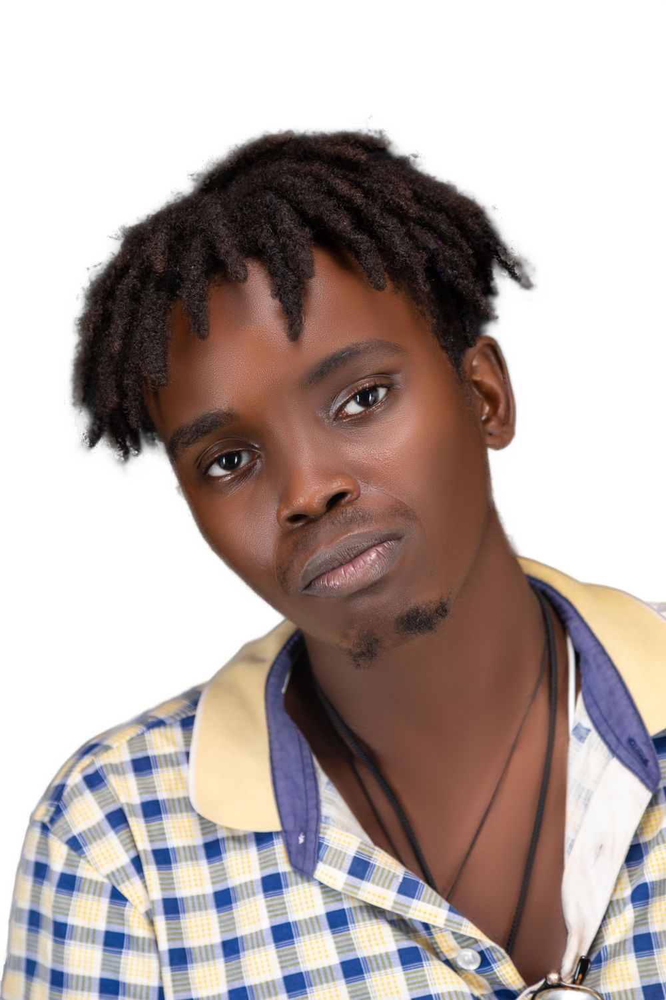
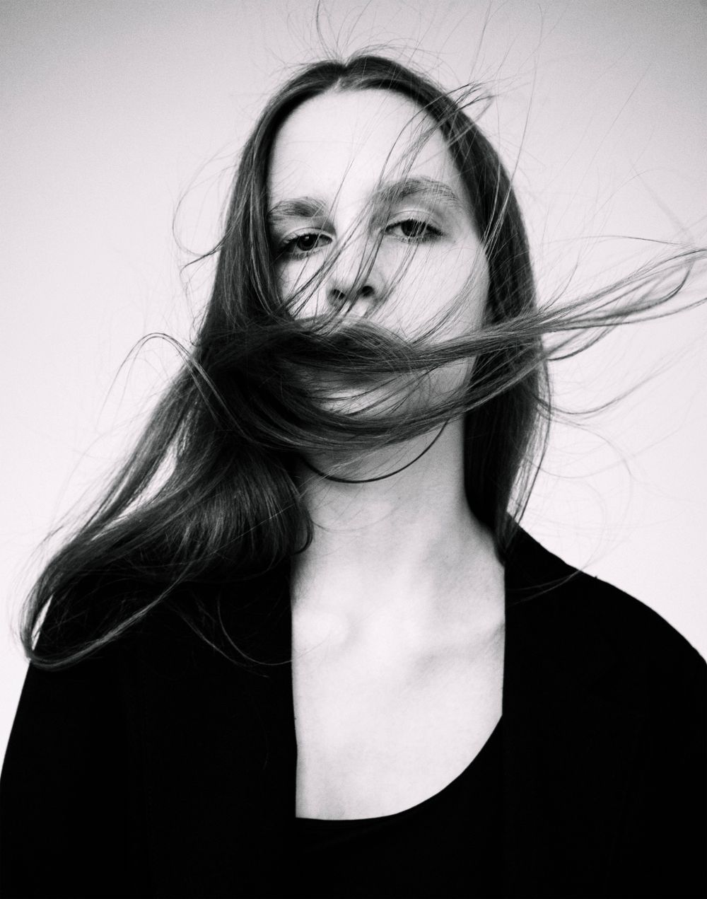
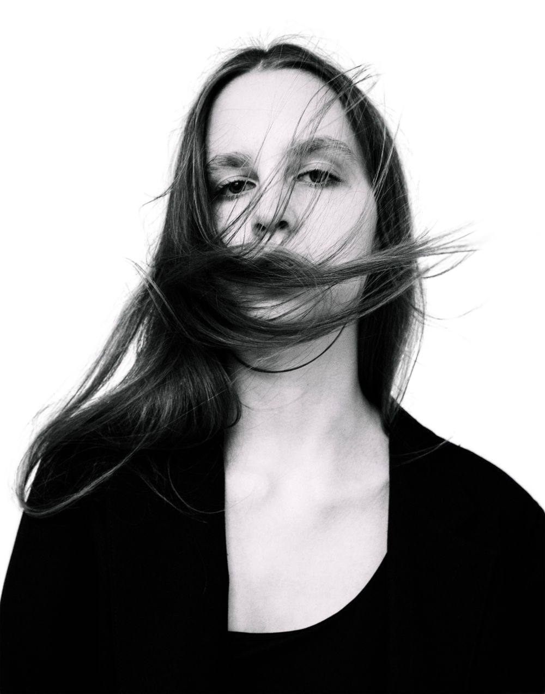
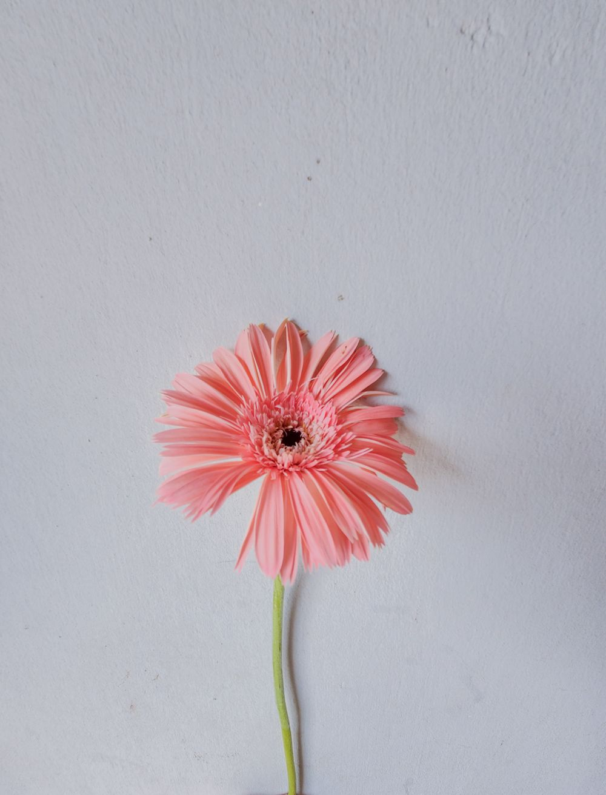
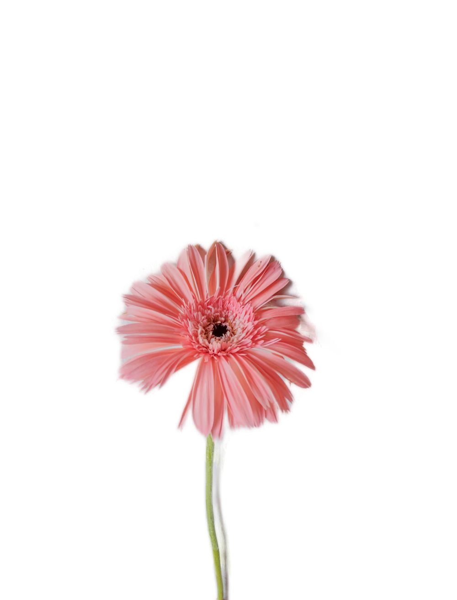

# delete.bg

Remove a photo background in your browser, touch up the edges, and save a transparent PNG at the original resolution. Photos stay on your device. Processing runs on the CPU and works in Chrome and Edge on Windows with hardware acceleration turned off.

[Open the app](https://andriii0.github.io/delete.bg/)

## Edit a photo

1. Drop a photo onto the page, click to choose a file, or paste with **Ctrl+V**. Processing starts automatically. The browser downloads the models on first use and caches them for later.
2. Switch between **Original** and **Cutout** to inspect the same detail. Scroll to zoom around the pointer and drag with **Pan** to move. White and black backgrounds help reveal fringes around hair.
3. Use **Erase** or **Restore** with the brush, lasso, circle, or rectangle. Restore shows a faint copy of the original to guide you. Undo with **Ctrl+Z** and redo with **Ctrl+Shift+Z** or **Ctrl+Y**.
4. Use **Copy PNG** (**Ctrl+C**) or **Download PNG** to export. Both preserve transparency and exclude the preview background.

The interface is available in English and Russian. If Auto misses part of the subject, try **Portrait & hair** (MODNet) or **Object** (U²-Netp), then click **Apply**. Manual editing also works if a model fails to load.

Use two fingers to zoom or pan on a touchscreen. The editor accepts up to 16 megapixels (16,777,216 pixels), with a maximum side of 8,192 pixels. **Delete saved draft** removes this tab’s saved photo and edits while keeping the editor open. On the next visit, the app removes inactive drafts older than seven days.

## Run locally

Run this command from the project root with Python 3, then open [localhost:8000](http://127.0.0.1:8000/).

```console
python serve.py
```

## Publish to GitHub Pages

The `site/` directory contains the complete static app, including the models. It requires no build step.

1. In a public fork or copy of this repository, go to **Settings → Pages** and select **GitHub Actions** as the source.
2. Push to `main`, or run **Actions → Publish delete.bg → Run workflow**. The workflow versions the asset URLs, verifies the model files, tests the release in headless Chrome and publishes it.

## Examples

These are full-resolution exports from **Auto** without manual edits. Click a cutout to open its transparent PNG. For enlarged edge comparisons on white and black backgrounds, see the [CPU benchmarks and comparison sheets](examples/README.md).

| Photo | Original | Cutout |
| --- | --- | --- |
| Dark locs against a dark background |  | [](examples/locks-export.png) |
| Windswept hair |  | [](examples/wisps-export.png) |
| Pink gerbera |  | [](examples/flower-export.png) |
